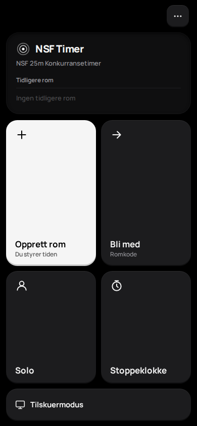
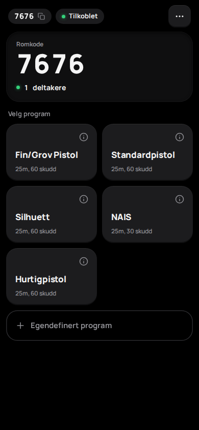
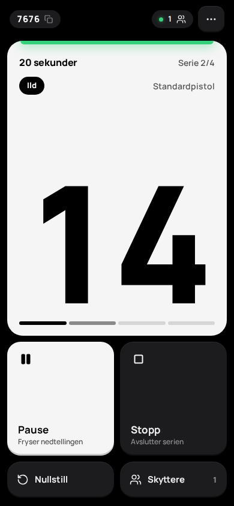
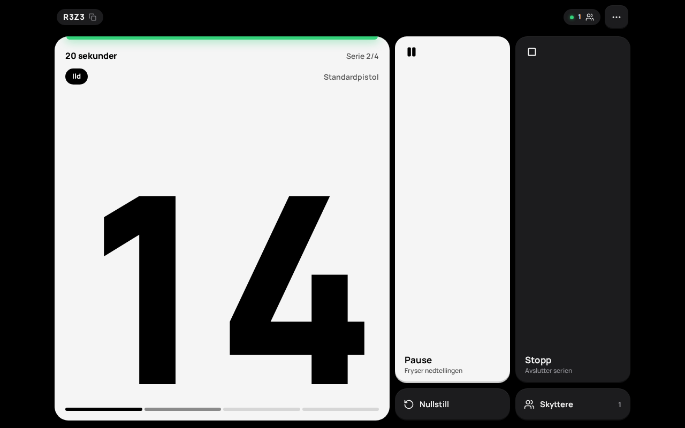

<p align="center">
  
</p>

<h1 align="center">NSF Timer</h1>

<p align="center">
  Synchronized timer for NSF 25m shooting competitions.<br>
  Install it on any phone, tablet, or computer and run competitions across multiple devices.
</p>

<p align="center">
  
  &nbsp;&nbsp;
  
  &nbsp;&nbsp;
  
</p>

<p align="center">
  
</p>

## Features

- **Built-in NSF programs.** Fine/Heavy Pistol, Standard, Silhouette, NAIS and Rapid Fire, with full stage and series timing.
- **Custom programs.** Create, edit and delete your own programs. Stage types are precision, rapid and duel.
- **Multi-device sync.** The host creates a room and shooters join with a 4-character code. Timer state syncs in real time over WebSocket.
- **Malfunction handling.** Tracks malfunctions per shooter (max 2 per program, 1 per stage) and starts reshoots.
- **Solo mode.** Run a full program on one device without a room.
- **Spectator screen.** A landscape view with no controls for a monitor or tablet at the range.
- **Stopwatch.** Counts up, or down from a time you set.
- **Offline PWA.** Install it to the home screen. Fonts and the app are cached, so it works without internet after the first load.
- **Norwegian and English.**
- **Settings.** Sound, screen wake lock, text size, language, and countdown and stopwatch formats.

## The screen

Every screen is a recessed display on top with large keys underneath, in black, white and greys. The white key is always the one to press next, and its small text says what it starts.

A lamp strip along the top of the display shows whether to shoot:

| Lamp | Display | Meaning |
|------|---------|---------|
| Off | Dark | Nothing is running |
| Red | Dark | Loading, targets turned away (Klar), paused or stopped |
| Green | White | Targets facing the shooters (Ild) |

Because the display also turns white on Ild, the signal still reads for shooters who can't tell red from green, and from across the firing line.

Change program, jump to stage, refresh and disconnect sit in the ⋯ menu, so the timer screen only shows what you press during a match. Dialogs and pickers open as bottom sheets within thumb reach.

## How it works

1. The **host** creates a room and picks a program.
2. **Shooters** join with the room code, their name and lane number.
3. The host runs the timer: start, pause, stop, next series, reset.
4. Every connected phone and spectator screen shows the same countdown and lamp.

## Self-hosting with Docker

The Docker image bundles the Svelte frontend and WebSocket relay server into a single container. Nginx serves the static files and proxies `/ws` to the Node.js relay server internally.

```bash
docker run -d -p 80:80 ghcr.io/gilbn/nsf-timer:latest
```

Access the app at `http://<server-ip>/`.

For internet-facing deployments, restrict WebSocket origins:

```bash
docker run -d -p 80:80 \
  -e WS_ALLOWED_ORIGINS=https://timer.example.com \
  ghcr.io/gilbn/nsf-timer:latest
```

For HTTPS, place the container behind a reverse proxy (e.g. Caddy, Traefik, nginx Proxy Manager) that handles TLS termination. The app automatically upgrades to `wss://` when served over HTTPS.

> **Note:** PWA features (install to home screen, offline support, screen awake) require HTTPS. The app works over plain HTTP, but browsers will not offer the install prompt or register the service worker without a secure context.

### Docker Compose

```yaml
services:
  nsf-timer:
    image: ghcr.io/gilbn/nsf-timer:latest
    ports:
      - "80:80"
    restart: unless-stopped
    environment:
      WS_ALLOWED_ORIGINS: "*"
```

### Reverse proxy examples

Below are minimal examples for putting the container behind a reverse proxy with HTTPS. The key requirement is that the `/ws` path must proxy WebSocket connections (HTTP `Upgrade` header).

<details>
<summary><strong>Caddy</strong></summary>

```
timer.example.com {
    reverse_proxy nsf-timer:80
}
```

Caddy handles HTTPS automatically and proxies WebSocket upgrades out of the box — no extra configuration needed.

</details>

<details>
<summary><strong>Nginx</strong></summary>

```nginx
server {
    listen 443 ssl;
    server_name timer.example.com;

    ssl_certificate     /etc/ssl/certs/cert.pem;
    ssl_certificate_key /etc/ssl/private/key.pem;

    location / {
        proxy_pass http://nsf-timer:80;
    }

    location /ws {
        proxy_pass http://nsf-timer:80;
        proxy_http_version 1.1;
        proxy_set_header Upgrade $http_upgrade;
        proxy_set_header Connection "upgrade";
    }
}
```

</details>

<details>
<summary><strong>Traefik (Docker labels)</strong></summary>

```yaml
services:
  nsf-timer:
    image: ghcr.io/gilbn/nsf-timer:latest
    labels:
      - "traefik.enable=true"
      - "traefik.http.routers.nsf-timer.rule=Host(`timer.example.com`)"
      - "traefik.http.routers.nsf-timer.entrypoints=websecure"
      - "traefik.http.routers.nsf-timer.tls.certresolver=letsencrypt"
      - "traefik.http.services.nsf-timer.loadbalancer.server.port=80"
    environment:
      WS_ALLOWED_ORIGINS: "https://timer.example.com"
```

Traefik handles WebSocket upgrades automatically.

</details>

## Environment variables

### Frontend (build-time)

| Variable | Default | Description |
|----------|---------|-------------|
| `VITE_WS_SERVER_URL` | `/ws` | WebSocket server URL. Relative paths are resolved against the current host at runtime |
| `VITE_BASE_PATH` | `/` | Base path for the app (e.g. `/timer/` if hosted under a subpath). The Docker image assumes `/` |
| `VITE_HTTPS` | `false` | Set to `true` to enable HTTPS on the Vite dev server |

### Server (runtime)

| Variable | Default | Description |
|----------|---------|-------------|
| `WS_PORT` | `8080` | Port the WebSocket relay server listens on |
| `WS_ALLOWED_ORIGINS` | `*` | Comma-separated list of allowed origins for WebSocket connections |

## Getting started

Requires Node.js 24 or newer.

```bash
npm install
npm run dev
```

Open `http://localhost:5173` in your browser.

The dev server proxies `/ws` to `localhost:8080`. Start the WebSocket relay server in a separate terminal:

```bash
cd server && npm install && npm run dev
```

If port 8080 is taken, start both with the same `WS_PORT`, for example `WS_PORT=8091`.

Checks:

```bash
npm test          # unit and integration tests (Vitest)
npm run check     # svelte-check type checking
npm run lint      # ESLint
```

## Tech stack

- [Svelte 5](https://svelte.dev/) for the UI
- [Vite](https://vite.dev/) to build and serve it
- [Tailwind CSS v4](https://tailwindcss.com/) for the design tokens in `src/styles/global.css`
- [Manrope](https://fontsource.org/fonts/manrope), self-hosted through Fontsource so it works offline
- [vite-plugin-pwa](https://vite-pwa-org.netlify.app/) for the service worker and manifest
- [ws](https://github.com/websockets/ws) for the WebSocket relay server (Node.js)
- [Nginx](https://nginx.org/) to serve the static files and proxy WebSockets in Docker
